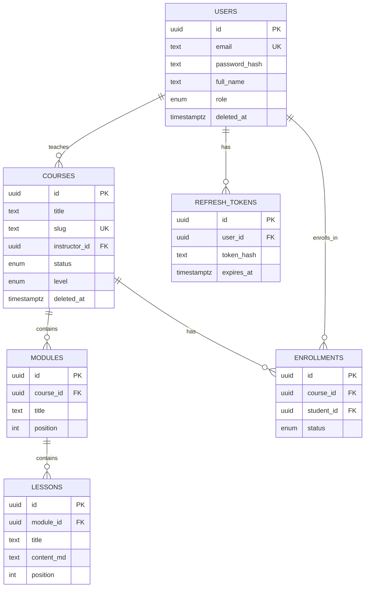

# Lumen LMS - Architecture

## Request flow

The web app never talks to the database directly. It only talks to the API. The API is the only thing that talks to Postgres.

```
Browser (Next.js, :3000)
   -> fetch, credentials: include
Express API (:4000)
   -> Prisma
Postgres (Docker, :5432)
```

## Auth flow

1. Login/register sets two httpOnly cookies: a 15-minute JWT access token and a 7-day refresh token (stored server-side as a SHA-256 hash, never plaintext).
2. Every protected route runs `requireAuth`, which verifies the JWT, then re-fetches the user from the database on every single request - it never trusts the token's role field alone. This means a role change or a ban takes effect immediately, not after the old token expires.
3. `requireRole(...)` stacks on top of `requireAuth` as a separate check, so authentication and authorization are always two distinct steps.
4. If the access token expires mid-session, the frontend's `apiFetch` helper automatically calls `/api/auth/refresh` once and retries the original request - the user never sees a random logout.

## Entity-relationship diagram (Foundations tables)



`modules`, `lessons`, and `enrollments` exist in the schema now but have no features built on them yet - that comes in Milestone 2. Designing their shape now means fewer migrations later.
